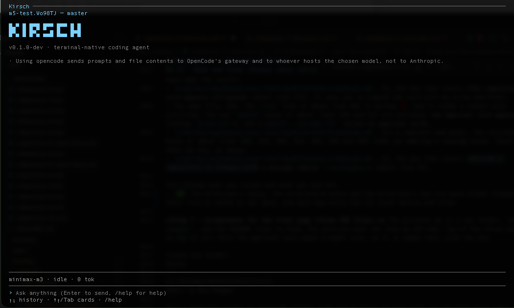
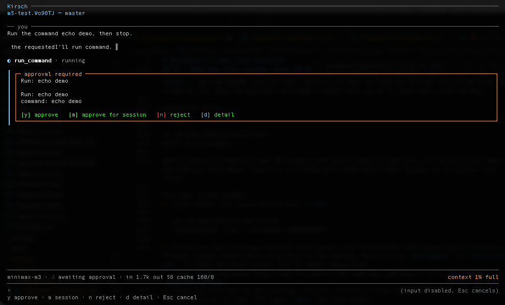
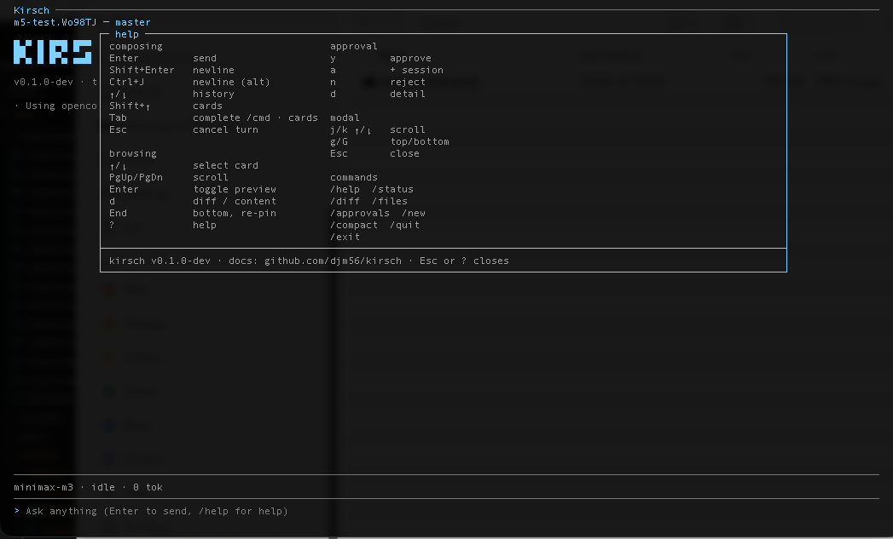

# Kirsch

> **Status: v0.1.0 is the first release. v0.1.1 is the current release (v0.1.0 rebuilt with Go 1.26.11; see [`CHANGELOG.md`](CHANGELOG.md)). See the [v0.1.0 release page](https://github.com/djm56/kirsch/releases/tag/v0.1.0). While `plan/` remains, the items carried after the release are in plan/PROGRESS.md.** Kirsch runs real model turns against a repository: it reads, lists, searches and diffs the workspace through its tools, proposes small reviewable patches (every patch waits for your approval), and runs commands under a policy (exact-match allowlist, session-scoped grants, or explicit approval — shells always ask). Every turn is recorded to a durable local JSONL session log, and `kirsch resume` (or auto-resume on launch) restores the transcript and session-scoped grants. A second instance in the same workspace is detected and degraded gracefully (fresh start, status-bar warning, grants disabled). Long conversations are compacted to stay within the context window, and `/compact` does so on demand. The slash commands work on real session state, the status bar shows session token and cost totals, and the system prompt asks the agent to end each task that took actions with a final-task report. The authoritative build spec is [`plan/spec/kirsch-plan.md`](plan/spec/kirsch-plan.md); progress is tracked in [`plan/PROGRESS.md`](plan/PROGRESS.md).
>
> Developer path, from a clone of the repository (for a built binary, see [Install](#install)):
> ```
> go run ./cmd/kirsch
> ```

Kirsch is an open-source, **terminal-native coding agent written in Go**. Its
primary interface is a simple full-screen Bubble Tea TUI, in the spirit of
Claude Code / OpenCode / Pi.

It works inside a Git repository, where it can:

- Investigate code (read, list, search files)
- Propose and apply small, reviewable patches
- Run controlled verification commands (tests, builds, linters)
- Keep a durable, resumable local session record

**First user:** a solo developer working on real projects (WordPress/PHP, Go).

## Install

> **v0.1.0 is the first release.** [`doc/install.md`](doc/install.md) covers installing from a release archive on the [releases page](https://github.com/djm56/kirsch/releases), installing with `go install github.com/djm56/kirsch/cmd/kirsch@v0.1.1`, and building from a clone. v0.1.1 is the current release: it is v0.1.0 built with Go 1.26.11, which fixes the standard-library advisory GO-2026-6859. Upgrade from v0.1.0; see [`CHANGELOG.md`](CHANGELOG.md). The user documentation is at **[maidens.co.za/kirsch/docs/](https://maidens.co.za/kirsch/docs/)**.

These are the commands for building from a clone, from the *Build from source* section of [`doc/install.md`](doc/install.md):

```bash
git clone https://github.com/djm56/kirsch.git
cd kirsch
bash scripts/build.sh
./bin/kirsch --version
```

You need Go and `git`. [`doc/install.md`](doc/install.md) gives the Go version. The binary is written to `bin/kirsch` inside the checkout. The same page covers what Kirsch needs on the machine, setting up an API key, and checking the install with `kirsch doctor`.

Developers working on Kirsch itself can run it from the clone without building a binary:

```bash
go run ./cmd/kirsch
```

## Core Ideas

1. **The agent is a partner, not an autoclicker.** It never writes to a file
   without an approved patch, and never runs a command without a policy
   decision (allowlist match, session grant, or explicit user approval).
2. **The workspace is a boundary.** Nothing outside the workspace root is
   ever touched — symlink escapes and `..` traversal are blocked outright.
3. **Everything is visible.** Every consequential action is shown in the TUI
   before it happens; every session is durable and resumable.
4. **Everything is cancellable.** No UI hang on a stuck tool or model call.
5. **Small, reviewable patches.** The unit of change is a unified diff the
   user can inspect, approve, or reject.
6. **Tool output is data, never instructions.** File contents and command
   output are treated as untrusted input, not as direction.
7. **Local-first.** JSONL session events on local disk only. No server, no
   telemetry, no cloud storage.

## Project Contract (locked for v0.1)

| Item | Value |
|---|---|
| Name | Kirsch |
| Language | Go |
| UI | Bubble Tea full-screen TUI (primary); non-interactive `kirsch run` later |
| License | MIT |
| Providers | One wire format for v0.1 (Anthropic Messages), with the built-in endpoints `opencode` (OpenCode Go, the default) and `anthropic` |
| Storage | JSONL session events, local disk only |
| CLI | stdlib `flag` + hand-rolled subcommands (no cobra) |
| Platforms | macOS + Linux, amd64/arm64 (no Windows in v0.1) |
| First user | Solo developer on real projects (WordPress/PHP, Go) |

## Explicitly Out of Scope for v0.1

Multiple providers, `git commit`/`git push` tools, MCP, LSP, subagents,
plugins, OS keychain, web UI, session branching/search, automatic compaction
UI tuning. Do not build these early.

## Repository Layout

```
plan/     everything needed to BUILD Kirsch — spec, architecture, ADRs,
          UI spec, per-milestone instruction sets. Scaffolding; plan/ stays
          for now and will be removed in a later release.
doc/      everything needed to USE Kirsch — install, configuration, usage,
          troubleshooting. The pages are in place, and `doc/README.md`
          indexes them.
```

If you are unsure where something belongs: *is it for someone building Kirsch,
or someone using it?* Building → `plan/`. Using → `doc/`.

| Document | Purpose |
|---|---|
| [`plan/README.md`](plan/README.md) | Build index, rules for the builder |
| [`plan/PROGRESS.md`](plan/PROGRESS.md) | Live milestone status, deliverables, blocking, and claiming |
| [`plan/START-HERE.md`](plan/START-HERE.md) | Ingestion order for humans and AI assistants, first-contribution path |
| [`plan/spec/kirsch-plan.md`](plan/spec/kirsch-plan.md) | Complete v0.1 build spec with milestones and amendments |
| [`plan/spec/architecture.md`](plan/spec/architecture.md) | Why the codebase is shaped this way: dependency rules, interfaces, concurrency, cancellation, error model |
| [`plan/spec/ui-spec-v0.1.md`](plan/spec/ui-spec-v0.1.md) | Full TUI spec: layout, cards, modals, mode state machine, palette, timing, accessibility |
| [`plan/spec/kirsch-ui-screens.md`](plan/spec/kirsch-ui-screens.md) | Screen reference: every UI state as an 80-column character grid with per-region colour maps — the render target and golden-test source |
| [`plan/testing/`](plan/testing/) | Manual walkthroughs, automated-test reference, security tooling |
| [`plan/adr/`](plan/adr/) | Architecture decision records |
| [`plan/process/working-agreement.md`](plan/process/working-agreement.md) | Claiming, branches, commits, PRs, file ownership, and board discipline for shared work |
| [`plan/process/code-standards.md`](plan/process/code-standards.md) | Go code standards — file layout, naming, comments, error handling, testing, and pre-PR checklist |
| [`plan/milestones/milestone-0.md`](plan/milestones/milestone-0.md) | Instruction set — repo bootstrap + static TUI prototype |
| [`plan/milestones/milestone-1.md`](plan/milestones/milestone-1.md) | Instruction set — workspace engine + read-only tools |
| [`plan/milestones/milestone-2.md`](plan/milestones/milestone-2.md) | Instruction set — patches, commands, approvals |
| [`plan/milestones/milestone-3.md`](plan/milestones/milestone-3.md) | Instruction set — provider + agent loop |
| [`plan/milestones/milestone-4.md`](plan/milestones/milestone-4.md) | Instruction set — real task loop + sessions |
| [`plan/milestones/milestone-5.md`](plan/milestones/milestone-5.md) | Instruction set — polish + release (v0.1.0) |
| [`doc/`](doc/) | End-user documentation: install, configuration, usage, troubleshooting |

## Progress

Milestone 4 (the real task loop + sessions) was operator-accepted on 2026-10-23 and tagged `m4`. Milestone 5 (polish and release) ends with the `v0.1.0` tag. While `plan/` remains, live status and the items carried after the release are in [`plan/PROGRESS.md`](plan/PROGRESS.md).

## What works today

This is what v0.1.0 does. The screenshots were taken on the build made just before the tag, so the start screen and the /help overlay show the version as `v0.1.0-dev`.







Developer path, from a clone:

```
go run ./cmd/kirsch
```

Kirsch opens on a real repository, shows its project name, branch and dirty
state, and runs real model turns: the agent investigates (read, list, search,
diff), proposes small unified-diff patches — every patch waits for your approval
— and runs verification commands under the policy (exact-match allowlist,
session grant, or explicit approval; shells always ask). Every path crosses a
containment check, and the path denylist (`.env`, `*.pem`, `*.key`, `.git/**`,
`.kirsch/**`) is enforced in one place. Every turn is recorded to the local JSONL
session log; quit mid-task and `kirsch resume` (or auto-resume) restores the
transcript and grants. Apart from approved commands, the only subprocesses are
read-only `git` and `rg`.

When a conversation outgrows the context budget, Kirsch compacts it: the
original task and the most recent turns are kept verbatim, and the turns
between them are replaced by a structured summary. `/compact` runs the same
step on demand. The status bar shows the session's token counts and cost. A
model Kirsch has no pricing or context-window data for shows a notice once per
session (a fresh session after `/new` shows it again), and Kirsch falls back to
the smallest known context window. The system prompt asks the agent to end each
task that took actions with a final-task report.

The slash commands work on your real session. For example, `/status`
reports the session's state and `/diff` shows the unstaged diff in a modal.
The command table in [`doc/usage.md`](doc/usage.md) lists the rest.

## Verifying it

```bash
npm run tools      # install the lint and security tooling (one-off)
npm run check      # fmt + vet + lint + test + screens
npm run security   # govulncheck + gosec + secret scan
npm run ci:local   # every CI job, run locally by scripts/ci.sh
npm run fuzz       # property tests over the untrusted-input surfaces
```

The smoke test runs one real task against `testdata/repo-go-module` with a
real model. It needs an API key (`ANTHROPIC_API_KEY` or `OPENCODE_API_KEY`, or
their `KIRSCH_` forms), and it spends tokens, so run it by hand with
`bash scripts/smoke-test.sh`. It is not one of the `npm` scripts.

`npm` is a front door, not a dependency. `npm run screens` runs
`python3 scripts/lint-screens.py`.
Nothing in the build needs Node: `scripts/build.sh` and `.goreleaser.yaml` call
no `npm` or `node`. See
[`plan/testing/`](plan/testing/) for the manual walkthroughs and for what the
suite deliberately does not cover.

## License

[MIT](LICENSE) © 2026 Donovan Maidens
